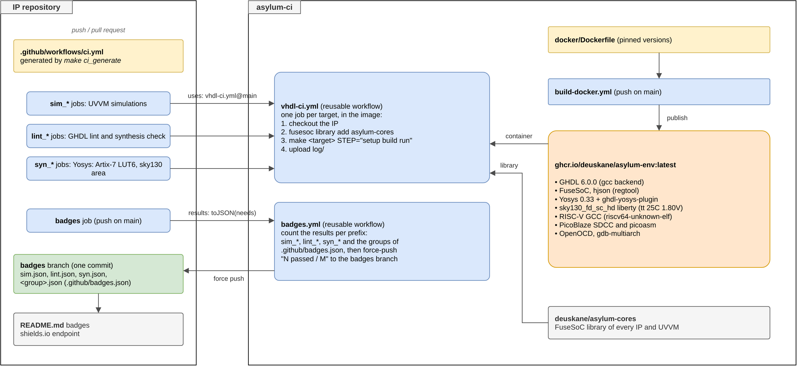

[](https://github.com/deuskane/asylum-ci/actions/workflows/build-docker.yml)
[](LICENSE)

# asylum-ci

**One container image and two reusable GitHub workflows that simulate, lint and synthesize every Asylum IP, and publish their pass counts as README badges.**

Part of the [Asylum project](https://github.com/deuskane/asylum-project), a collection of small IP cores, written to be read and learned from.

## Overview

Each Asylum IP runs the same CI, with the same tools:

- **Every FuseSoC target is a job.** The IP's `.github/workflows/ci.yml` has one job per `sim_*`, `lint_*` and `syn_*` target. It is generated by `make ci_generate` and calls [vhdl-ci.yml](.github/workflows/vhdl-ci.yml).
- **The CI runs exactly what you run locally.** Each job runs `make <target>` inside [`ghcr.io/deuskane/asylum-env`](https://github.com/deuskane/asylum-ci/pkgs/container/asylum-env), the same image you use on your machine.
- **Pass counts become badges.** On a push to `main`, [badges.yml](.github/workflows/badges.yml) counts the jobs that passed per kind. It writes the counts as [shields.io endpoint](https://shields.io/badges/endpoint-badge) files on the IP's `badges` branch, and the README badges read them from there.



## The asylum-env image

The image is built from [docker/Dockerfile](docker/Dockerfile) by [build-docker.yml](.github/workflows/build-docker.yml) on every push to `main`, and published as `ghcr.io/deuskane/asylum-env:latest`. Every tool is installed at build time, so the image also works without network access.

| Tool | Version | Used by |
|---|---|---|
| GHDL (gcc backend) | 6.0.0, base image `ghdl/ghdl:6.0.0-gcc-ubuntu-24.04` | `sim_*`, `lint_*` |
| FuseSoC, edalize, hjson, jsonschema, prettytable | 2.4.7, 0.6.8, 3.1.0, 4.26.0, 3.19.0 (pip, dependencies pinned too) | every target, regtool generator |
| Yosys | 0.33 (Ubuntu 24.04 package `0.33-5build2`) | `syn_*` |
| ghdl-yosys-plugin | commit of tag `ghdl-v6.0.0`, built against the same libghdl | `syn_*` (VHDL front end) |
| sky130_fd_sc_hd liberty | typical corner `tt_025C_1v80`, pinned commit and sha256, `$ASIC_LIBERTY` | `syn_*` (ASIC area) |
| RISC-V GCC | Ubuntu `gcc-riscv64-unknown-elf`, `$RISCV_PREFIX` | rvcc generator (WardRV, PicoSoC firmware) |
| PicoBlaze SDCC and picoasm | built from [asylum-utils-generators](https://github.com/deuskane/asylum-utils-generators) (pinned commit), `$PBCC_HOME` | pbcc generator (OpenBlaze8 firmware) |
| OpenOCD, gdb-multiarch | Ubuntu packages | WardRV debug unit co-simulation |

The two build stages (the ghdl-yosys-plugin, and the PicoBlaze toolchain) do not end up in the image: only their output is copied.

## Using it in an IP

The IP Makefile generates the jobs from the targets of the core:

```sh
make ci_generate     # after adding, renaming or removing a sim_*, lint_* or syn_* target
```

This writes one job per target, plus the `badges` job, between the `#<GENERATE_BEGIN>` and `#<GENERATE_END>` markers of `.github/workflows/ci.yml`:

```yaml
jobs:
  sim_basic:
    uses: deuskane/asylum-ci/.github/workflows/vhdl-ci.yml@main
    with:
      name: sim_basic                 # FuseSoC target, run as `make sim_basic`

  badges:
    needs: [sim_basic, lint_ghdl, syn_default]
    if: always() && github.event_name == 'push' && github.ref == 'refs/heads/main'
    permissions:
      contents: write
    uses: deuskane/asylum-ci/.github/workflows/badges.yml@main
    with:
      results: ${{ toJSON(needs) }}
```

[vhdl-ci.yml](.github/workflows/vhdl-ci.yml) takes two inputs:

| Input | Default | Description |
|---|---|---|
| `name` | (required) | Target, run as `make <name>` |
| `step` | `setup build run` | FuseSoC steps, passed as `STEP` |

The job registers the [asylum-cores](https://github.com/deuskane/asylum-cores) FuseSoC library, so the IP finds its dependencies at the imported versions. It also uploads the `log/` directory as an artifact, even when the target fails.

## Badges

[badges.yml](.github/workflows/badges.yml) groups the jobs of the run by name prefix and writes one endpoint file per group, `"N passed / M"` in green or `"N passed, K failed / M"` in red:

| File | Jobs |
|---|---|
| `sim.json` | `sim_*` |
| `lint.json` | `lint_*` |
| `syn.json` | `syn_*` |
| `<name>.json` | the extra groups of the IP's `.github/badges.json` |

An IP adds its own groups in `.github/badges.json`. The WardRV processor, for example, adds one badge per architecture test suite:

```json
[{"name": "act3_rv32i", "label": "ACT3 RV32I", "prefix": "sim_compliance_act3_"},
 {"name": "act4_zicsr", "label": "ACT4 Zicsr", "prefix": "sim_compliance_act4_zicsr_"}]
```

The `badges` branch is an orphan branch with a single commit. That commit is force-pushed only when a count changes, so it never grows. A README badge reads the file through shields.io:

```markdown
[](https://github.com/deuskane/<repo>/actions/workflows/ci.yml)
```

## Running locally

GHDL, Yosys and FuseSoC do not need to be installed on the host: run the targets in the image, with `docker` or `podman`. In an IP directory:

```sh
docker run --rm -v "$PWD":/workspace -w /workspace ghcr.io/deuskane/asylum-env:latest \
  bash -c "fusesoc library add https://github.com/deuskane/asylum-cores --global && make sim_basic CI=true"
```

`CI=true` disables the waveform dump, as in the CI. [docker/Makefile](docker/Makefile) builds and opens the image locally:

| Rule | Description |
|---|---|
| `make build` | Build the image from the Dockerfile (`asylum-ci:latest`) |
| `make run` / `make shell` | Start a container with the current directory mounted at `/workspace` |
| `make stop` | Stop the container |
| `make clean` | Remove the local image |
| `make purge` | Remove the Docker build cache and unused data |

## Updating the image

1. Change the pinned version in the `ARG` lines at the top of [docker/Dockerfile](docker/Dockerfile) (GHDL image, Yosys, plugin commit, generators commit, sky130 commit and checksum).
2. Build and run an IP regression locally with the new image (`make nonreg` in the IP).
3. Merge into `main`: build-docker.yml publishes the new `latest`, and every IP uses it on its next CI run.

## Repository Layout

```
asylum-ci/
├── .github/workflows/
│   ├── vhdl-ci.yml        # reusable: one FuseSoC target in the image
│   ├── badges.yml         # reusable: pass counts to the badges branch
│   └── build-docker.yml   # builds and publishes ghcr.io/deuskane/asylum-env
├── docker/
│   ├── Dockerfile         # asylum-env image, pinned versions
│   └── Makefile           # local build and run helpers
└── doc/
    ├── asylum-ci.drawio   # overview diagram (source)
    └── asylum-ci-Overview.png
```

## Related

- [asylum-project](https://github.com/deuskane/asylum-project): every IP, with its CI status
- [asylum-cores](https://github.com/deuskane/asylum-cores): FuseSoC library used by the CI
- [asylum-utils-generators](https://github.com/deuskane/asylum-utils-generators): FuseSoC generators and the `ghdl_synth` / `yosys_synth` hooks of the `lint_*` and `syn_*` targets

## License

Apache License 2.0, see [LICENSE](LICENSE).

The sky130_fd_sc_hd liberty file in the image is from the [FOSSi Foundation](https://github.com/fossi-foundation/skywater-pdk-libs-sky130_fd_sc_hd), Apache-2.0. Its license is shipped next to it, in `/opt/asic/sky130_fd_sc_hd.LICENSE`. The other tools in the image keep their own licenses.
